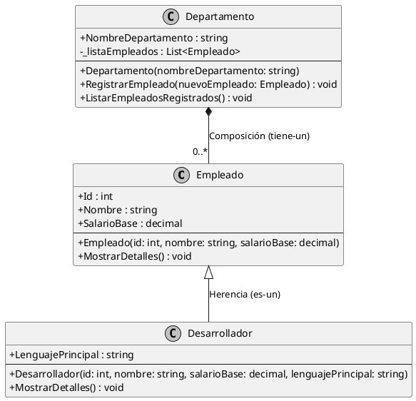

# Laboratorio 6.6 — Sistema de Gestión de Empleados (Herencia y Composición)

Proyecto interactivo en consola desarrollado en C# (.NET 8) demostrando relaciones avanzadas de Programación Orientada a Objetos.

---

## 📌 ENTREGABLE 1: Enlace al Repositorio Oficial en GitHub
- **URL del Repositorio:** [https://github.com/RaulNunez92/Laboratorio6_6_HerenciaComposicion](https://github.com/RaulNunez92/Laboratorio6_6_HerenciaComposicion)

---

## 📐 ENTREGABLE 2: Diagrama de Clases (UML)
*Nota para el evaluador: El diagrama en formato vectorial PDF se encuentra adjunto en la carpeta `/docs/DiagramaClases_Lab6_6.pdf` dentro de este mismo repositorio.*

### Especificación PlantUML:


---

## 📸 ENTREGABLE 3: Evidencias de Ejecución en Consola (Al menos 3 Objetos)

### Evidencia A: Registro Dinámico de Empleados y Desarrolladores
*(Muestra la captura capturando los datos en tiempo de ejecución sin valores fijos)*


### Evidencia B: Listado Polimórfico del Departamento
*(Muestra la impresión de los 3 objetos creados: por ejemplo, 1 Empleado Administrativo y 2 Desarrolladores)*


---

## 📦 ENTREGABLE 4: Entrega del Proyecto en Consola (Independiente de GitHub)
Para los evaluadores que requieren el ejecutable o el paquete compilado fuera de la nube:

### Instrucciones de compilación en local:
```bash
# Compilar y publicar como binario independiente:
dotnet publish -c Release -r win-x64 --self-contained false
```
*El ejecutable final se localiza en:*  
`bin/Release/net8.0/win-x64/publish/Laboratorio6_6_HerenciaComposicion.exe`

---

## 📝 ENTREGABLE 5: Respuestas a las Preguntas de Reflexión

1. **¿Qué propiedades se reutilizan mediante herencia?**  
   Se reutilizan `Id`, `Nombre` y `SalarioBase` de la clase base `Empleado`. La clase `Desarrollador` las recibe e inicializa llamando a `base(...)`, evitando la duplicación de código.

2. **¿Por qué Departamento no debería heredar de Empleado?**  
   Porque viola la relación «Es-Un». Un departamento no es un empleado (no tiene cédula, salario ni programa). La relación correcta es que el departamento agrupa empleados («Tiene-Un»).

3. **¿Qué ventajas ofrece la composición?**  
   Ofrece bajo acoplamiento, permite colecciones heterogéneas polimórficas (`List<Empleado>`) y protege el ciclo de vida de los objetos contenidos sin crear jerarquías de herencia complejas.
   